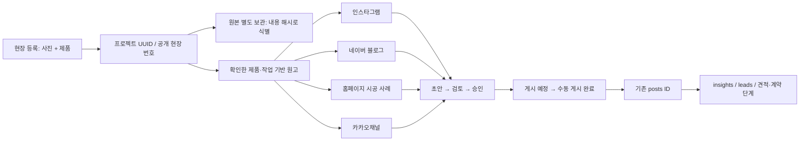

# 현장 중심 통합 마케팅 — 1차 구조와 검증본

작업 범위 `marketing/`. 기존 스마트 실측, 홈페이지·견적·회계 프로그램은 변경하지 않습니다. 현재 버전은 **로컬 업무 관리와 게시 자료 준비**이며 인증된 클라우드/CMS/SNS 자동 게시가 아닙니다.

## 기존 구조와 변경

기존 앱은 IndexedDB `cheonginmaru-marketing-v1`의 `projects/current`에 현재 현장을 저장하고 `project:<id>`에 보관합니다. 사진 편집·제품 도감·작성 엔진과 `posts → insights/leads` 연결은 유지합니다. 새 데이터도 같은 저장소에 선택 필드로 추가하며 `version:1`, `officeVersion:2`, `contentEngineVersion:1`을 바꾸거나 자료를 초기화하지 않습니다.

| 데이터 | 저장과 연결 |
|---|---|
| 현장 ID / 번호 | 기존 전체 UUID 유지 + 날짜 기반 공개 번호. 중복 번호 검사 |
| `projectIndex` | 공개 현장명, 지역, 공간, 제품, 사진 수, 현재 현장 메타데이터. 사진·고객 연락처 없음 |
| `channelJobs` | 현장 ID + 4개 채널. 독립 원고·상태·승인본·예정일·실제 게시일·게시 URL |
| 콘텐츠 버전 | 이전 생성 초안, 승인본, 이전 게시 버전을 보존. 승인 이후 원본 정보 변경은 `pendingDraft`로 분리 |
| `wf-photo:<SHA256>` | 원본·편집 소스와 실제 생성 PNG를 불변 키로 보관. 같은 원본은 중복 저장하지 않음 |
| `photoRefs` | 소스/원본 키, 해당 버전의 보정값·구도 참조. 원본이 교체돼도 이전 승인본 재구성 가능 |
| 생성 이미지 버전 | 렌더러 버전, 콘텐츠 차수, 생성 시각과 실제 PNG 파일 키. 전체 백업에 포함 |
| `posts` | 채널·현장·제품 스냅샷·작성 모드·실제 게시일. 게시 차수마다 다른 post ID |
| `insights`, `leads` | 기존 post ID를 통해 성과·유입·상담 단계를 연결. 기존 데이터를 삭제하지 않음 |

소스 정보 변경 뒤 새 게시 차수를 만들더라도 과거 post ID와 성과는 유지합니다. 게시 예정만 있었던 이전 차수는 제작 중으로 전환하며 실제 게시 기록으로 만들지 않습니다.

## 실제 동작하는 1차 범위

- 첫 화면: 오늘 할 일, 초안·검토·게시 예정·게시 완료, 기록된 월 팔로워 증감, 신규 상담, 현재 견적·계약 단계.
- 월 팔로워 증감은 비교 가능한 수동 계정 기록이 있을 때만 계산하고 관측 구간을 표시합니다. 단일 기록이나 무기록 상태는 `미기록`입니다. 콘텐츠 귀속 증가를 계정 순증가로 바꾸지 않습니다.
- 사진과 제품을 한 번 등록하면 4개 채널의 서로 다른 초안을 준비합니다. 선택하지 않은 작업·미확인 성능은 작성하지 않습니다. 제품 도감 91개 계열·377개 세부 모델과 가격 없는 규격을 그대로 사용합니다.
- 인스타: 기존 사진 보정·3개 디자인 방향 유지, 캐러셀·스토리·표지 PNG와 대본 ZIP, 선택 시 실제 1080×1920 MP4 렌더링. 영상은 출력 시 생성하며 자동 게시나 음악 권리 확보를 주장하지 않습니다.
- 네이버: 검색형 제목·제품/현장/작업 원고와 사진 순서, 원고·보정 사진 ZIP. 글쓰기 자동화·로그인 대행을 하지 않습니다.
- 홈페이지: 검토 후 승인된 원고만 `case.html + manifest.json + images/`로 내보냅니다. 개인 상담 데이터·단가·API 설정은 공개 manifest에 포함하지 않습니다. 같은 제품군의 실제 게시 URL이 기록된 다른 승인 사례가 있을 때만 관련 사례 링크를 넣습니다. 기존 홈페이지에는 쓰지 않습니다.
- 카카오: 사례 소개·상담 준비 Q&A·상담 안내. 현장에 실제 소비자 질문이 입력된 경우에만 마루니·루루 정보형 콘텐츠를 추천합니다. 메시지 발송은 하지 않습니다.
- 상태: 초안 → 검토 → 승인 → 게시 예정 → 게시 완료 → 성과 분석. 검토·승인을 건너뛰지 않으며 마지막 단계는 실제 성과/상담 기록을 요구합니다. 게시 완료는 사용자가 외부에 게시한 뒤 직접 기록하는 상태입니다.
- 현재 현장 네 채널을 한 번에 검토 요청하고 검토본을 한 번에 승인할 수 있습니다. 승인은 이 브라우저의 작업 기록이며 인증된 관리자 권한을 뜻하지 않습니다.
- 전체 백업은 현재 현장·보관함·기존 업그레이드 사본·업무 데이터·원본과 생성 PNG를 포함합니다. 누락/충돌한 사진 키는 복원 전에 검사합니다. MP4 파일은 다운로드로 별도 보관하며 DB에 바이너리 영상을 저장했다고 표시하지 않습니다.

## 단계별 미연결 기능

| 단계 | 다음 작업 / 필요한 준비 |
|---|---|
| 2차 CMS | 기존 홈페이지의 실제 소스·CMS API·인증 확인 후 승인된 공개 manifest만 전달. 별도 개발·인증 전 자동 등록 없음 |
| 2차 캘린더 | 1차부터 기존 달력과 연결됨. 예약 서버 실행·실제 외부 게시 예약은 미구현 |
| 3차 상담·견적·계약 | 기존 수동 단계·게시물 귀속을 유지. 견적 프로그램의 인증된 읽기 전용 export/API가 필요. 쓰기 권한 없음 |
| 3차 유입 추적 | 현재 수동 게시 주소·상담 출처 기록. 클릭 수집 서버·UTM 리포팅·웹훅은 후속 범위 |
| 4차 Meta | 비즈니스 계정·공식 앱·요구 권한/검수·서버 토큰 보관·실제 API 접근 검증이 필요. 현재 계정 권한 확인/자동 게시/성과 수집 미실행 |
| 4차 카카오 | 사용할 공식 상품·권한·인증과 수신 동의/광고성 발송 조건을 확정한 뒤 구현. 현재 발송 API·수신자 DB 없음 |
| 네이버 | 사용자 지시에 따라 원고·사진 생성 후 수동 게시. 종료된 글쓰기 API를 대체한다며 비공식 로그인 게시를 구현하지 않음 |

월간 운영 추천은 실제 플랫폼별 post/insight/lead 기록이 충분히 쌓인 뒤 수행합니다. 기록 없는 성공 확률·성과 점수를 만들지 않습니다.

## 클라우드 저장소·관리자 권한 검토

사무실·집의 자동 동기화는 **현재 동작하지 않습니다**. 로컬 자료를 클라우드에 조용히 전송하지 않습니다. 1차 이동 수단은 전체 JSON 백업·복원입니다.

권장 후속 구조는 Supabase Auth + Postgres RLS + 비공개 Storage 또는 동등한 Firebase 구성입니다. 실제 프로젝트·요금제·리전·업무 계정이 정해져야 연결할 수 있습니다.

- `workspaces`, `workspace_members(user_id, role)`에 관리자/편집/보기 역할. 인증 서버가 RLS로 강제하며 브라우저 토글을 권한으로 간주하지 않음.
- `projects`, `channel_jobs`, `content_versions`, `publications`, `metrics`, `leads`를 정규화하고 workspace ID로 범위를 제한.
- 원본/생성물은 비공개 버킷, 짧은 수명의 서명 URL과 사용자 권한 검사. 공개 승인본은 별도 allowlist projection으로만 CMS에 전송.
- 서비스 역할 키와 SNS 토큰은 서버 비밀 설정에 보관. 공개 HTML/Git에 저장하지 않음.
- 견적 읽기 전용 어댑터는 브랜드·제품명·모델·규격·색상·소재·박스 구성만 허용. `price`, `cost`, 매입단가, 마진, 고객명/전화/주소, 원본 인증 설정을 제외. 실제 DB export 형식과 접근 권한 확인 전 연결 없음.
- 로컬 JSON 백업은 500MB 제한입니다. 많은 원본·영상의 장기 운영에는 비공개 객체 저장소와 보존 정책이 필요합니다.

## 검증·배포 게이트

- `node marketing/tests/workflow_core.test.js`: 채널 구분, 사실 기반 문구, 상태 전이, 무기록 지표, 공개 allowlist.
- `STUDIO_TEST_OUTPUT=/tmp/workflow-evidence python marketing/tests/workflow_browser.py`: 현장 한 번 등록, 4개 채널, 수정/승인/예정/직접 완료/실제 지표, 공개 홈페이지 ZIP, IG PNG·MP4, 새 게시 차수의 과거 성과 보존, 두 현장 독립 관리, 원본·생성본 전체 복원, 반응형 화면.
- 기존 content engine / browser smoke 회귀를 유지합니다. 테스트 사진·모델·성과는 합성 자료이며 실제 고객 정보가 아닙니다.
- 루트 실측·자산 SHA-256을 비교하며 `marketing/` 밖을 변경하지 않습니다.
- 이번 통합 1차는 `feature/project-workflow-phase1` 검토 브랜치에 준비합니다. 요청하신 **코드 검증과 승인 후 배포** 원칙에 따라 승인 전에 main에 반영하지 않습니다. GitHub의 현재 자동 Pages 파이프라인에 새 보호 규칙을 설정했다고 주장하지 않습니다. 지속적인 자동화는 승인된 main 병합/수동 배포와 GitHub 환경 보호 규칙을 실제로 구성한 뒤 사용해야 합니다.
- 변경 전 코드 백업 `backup/before-project-workflow-20261105`는 `b166f2f`입니다. 코드 백업과 사용자의 실제 브라우저 데이터 백업은 별개이며, 업데이트 시 데이터 사본은 해당 브라우저에서 생성됩니다.
